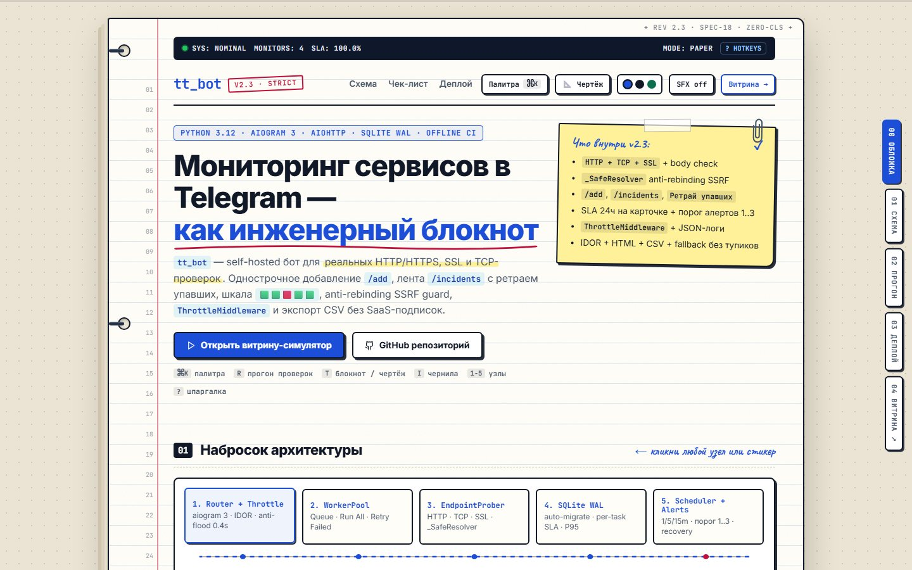

# tt_bot

> **Languages:** [English](README.md) · [Русский](README.ru.md)

Self-hosted Telegram endpoint and task monitor for HTTP/HTTPS, TLS certificates
and TCP services, with schedules, alerts, per-monitor SLA history and CSV export.
The full Russian documentation is in [README.ru.md](README.ru.md).

**Site:** https://ssrjkk.github.io/tt_bot/  
**Showcase:** https://ssrjkk.github.io/tt_bot/showcase/  
**Source:** https://github.com/ssrjkk/tt_bot

## Screenshot



## Features

- HTTP status and body checks, TLS expiry checks and TCP port probes.
- Anti-rebinding SSRF guard with redirects disabled by default.
- Background scheduler and bulk incident actions.
- Per-user Telegram isolation, anti-flood middleware and sanitized CSV export.
- SQLite WAL history, automatic migrations and structured JSON logs.
- Per-monitor SLA, P50/P95 latency and threshold alerts.

## Quick start

```bash
git clone https://github.com/ssrjkk/tt_bot.git
cd tt_bot
cp .env.example .env
docker compose up -d --build
```

Set `BOT_TOKEN` from BotFather. `ALLOW_PRIVATE_ENDPOINTS=true` is intended for a
controlled intranet stand, not a public deployment.

## Configuration

Key variables are `DB_PATH`, `WORKERS_COUNT`, `PROBE_TIMEOUT_SEC`,
`SCHEDULER_TICK_SEC`, `LOG_RETENTION_DAYS`, `THROTTLE_RATE_SEC` and `LOG_FORMAT`.
See `.env.example` for the complete list.

## Checks

```bash
pip install -r requirements-dev.txt
make lint
make test
make audit
```

## Documentation

- [Russian README](README.ru.md)
- [Architecture](ARCHITECTURE.md)
- [Security policy](SECURITY.md)

## License

MIT — see [LICENSE](LICENSE).
