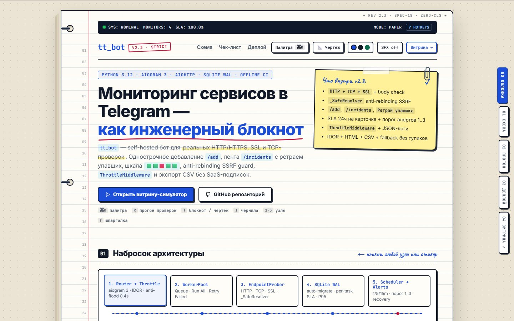
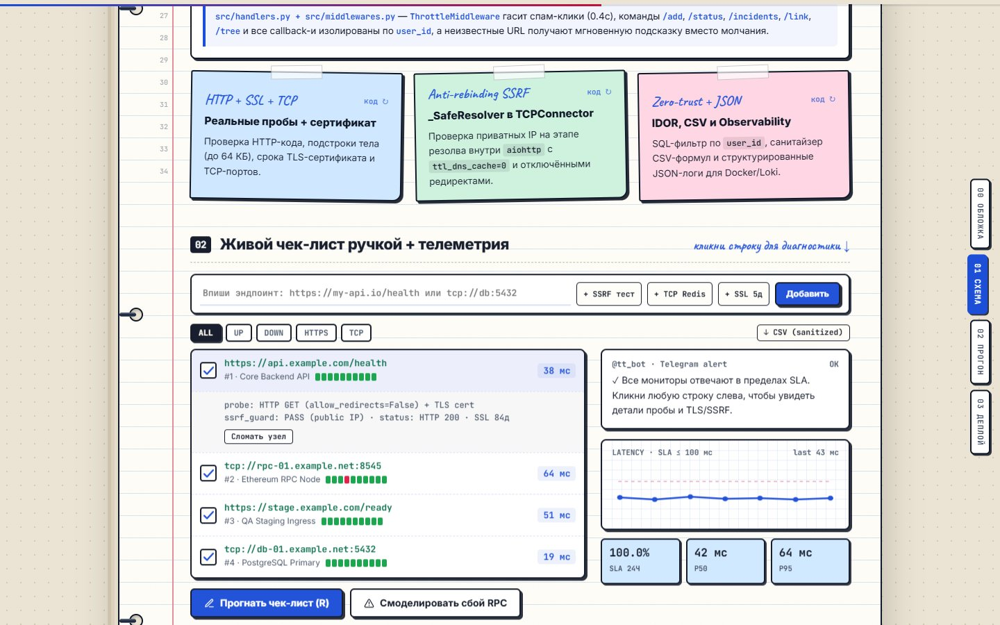
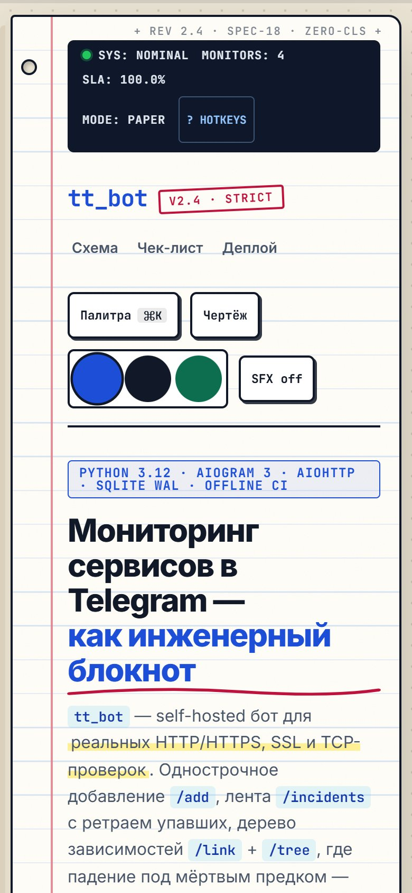

# tt_bot — Self-hosted Telegram Chat-Ops Monitor

> **Языки:** [English](README.md) · [Русский](README.ru.md)

Лёгкий self-hosted Telegram-бот для мониторинга HTTP/HTTPS, SSL-сертификатов и TCP-сервисов прямо из чата.
Один Docker-контейнер, SQLite WAL, anti-rebinding SSRF guard, расписание, умные алерты, быстрые команды (`/add`, `/incidents`, `/status`, `/stats`), визуальная история аптайма и спарклайн задержек, SLA/P95 по каждому монитору и экспорт в CSV.

**Сайт-блокнот (Блокнот / Чертёж + палитра `⌘K`):**
- Лендинг: https://ssrjkk.github.io/tt_bot/

---

**Сайт:** https://ssrjkk.github.io/tt_bot/

## Скриншоты

Сняты с опубликованного сайта в настоящем браузере (Chrome, 1440×900 и 390×844).

| Главная | Разделы |
| --- | --- |
|  |  |

<p align="center"></p>

## Возможности (v2.3)

- **Реальные HTTP/HTTPS, SSL и TCP-пробы (`src/probes.py`)**: проверка HTTP-кода, подстроки в теле (`expected_text`, до 64 КБ), срока действия TLS-сертификата (`ssl_min_days`) и TCP-портов.
- **Anti-rebinding SSRF Guard (`_SafeResolver`)**: проверка IP внутри `aiohttp.TCPConnector` с `ttl_dns_cache=0` и `allow_redirects=False` (для intranet включается `ALLOW_PRIVATE_ENDPOINTS=true`).
- **Фоновый планировщик (`MonitorScheduler`) + групповые действия**: авто-опрос каждые 1 / 5 / 15 мин, кнопки «Проверить все» и «Перепроверить упавшие» в `/incidents` и почасовая очистка старых логов.
- **Строгий Telegram UI/UX**: живая сводка прямо в главном меню, `/add Название https://url [мин]`, 5-шаговый FSM с индикатором шага, карточка монитора с бейджем `UP` / `DOWN`, per-monitor SLA 24ч, шкалой аптайма из 10 последних проб, сменой приоритета/интервала/порога алертов (`1..3`) в один клик и умный fallback (если скинуть сырой URL в чат — бот сразу даст готовую команду `/add`).
- **Безопасность и продакшен-гигиена**: `ThrottleMiddleware` (anti-flood), строгая SQL-изоляция по `user_id` (IDOR), `html.escape()`, санитайзер CSV Formula Injection (реестр и логи), структурированные JSON-логи (`LOG_FORMAT=json`) и авто-миграция БД с v1.x.

## Переменные окружения

| Переменная | По умолчанию | Описание |
|---|---|---|
| `BOT_TOKEN` | *(обязательно)* | Токен бота от `@BotFather` |
| `DB_PATH` | `data/tt_bot.db` | Путь к файлу SQLite |
| `WORKERS_COUNT` | `3` | Количество асинхронных воркеров |
| `PROBE_TIMEOUT_SEC` | `10` | Таймаут одной проверки (сек) |
| `SCHEDULER_TICK_SEC` | `15` | Интервал тика планировщика (сек) |
| `ALLOW_PRIVATE_ENDPOINTS` | `false` | Разрешить приватные/локальные IP (`true` для intranet) |
| `LOG_RETENTION_DAYS` | `30` | Срок хранения `execution_logs` (дней) |
| `THROTTLE_RATE_SEC` | `0.4` | Anti-flood лимит на пользователя (сек, `0` — выкл.) |
| `LOG_FORMAT` | `text` | Формат логов: `text` или `json` (включён в `docker-compose.yml`) |

## Быстрый старт

```bash
git clone https://github.com/ssrjkk/tt_bot.git
cd tt_bot
cp .env.example .env
# Пропиши BOT_TOKEN в .env
docker compose up -d --build
```

## Тесты и проверки качества (оффлайн CI)

```bash
pip install -r requirements-dev.txt
make lint
make test
make audit
```

---

**SSRJKK** — [GitHub](https://github.com/ssrjkk/tt_bot) · [Landing](https://ssrjkk.github.io/tt_bot/)

## Documentation

- [Architecture](ARCHITECTURE.md)
